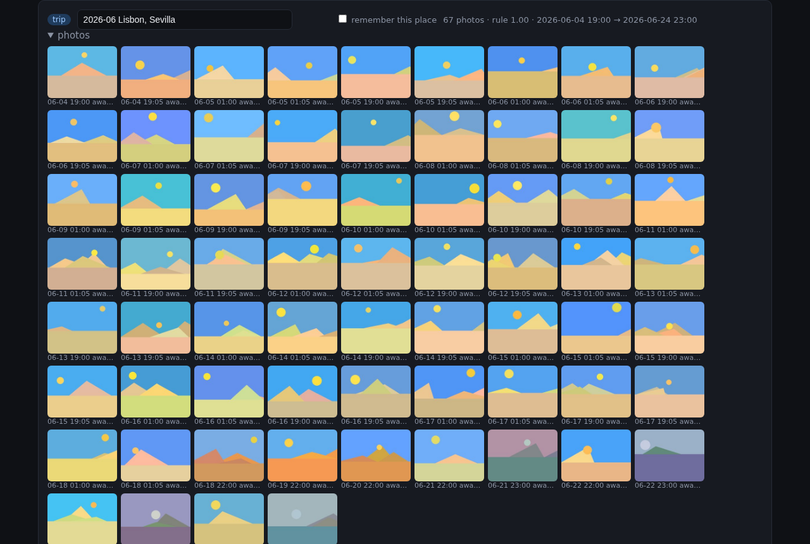
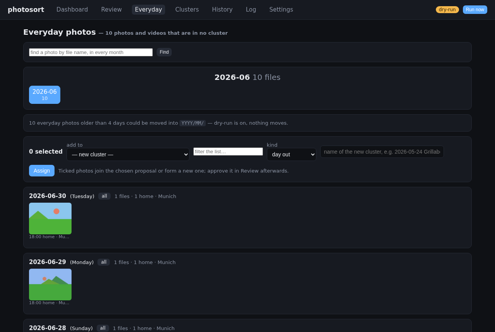
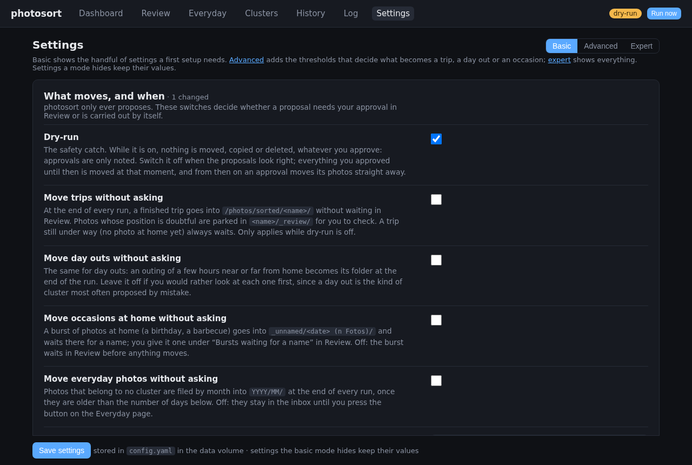
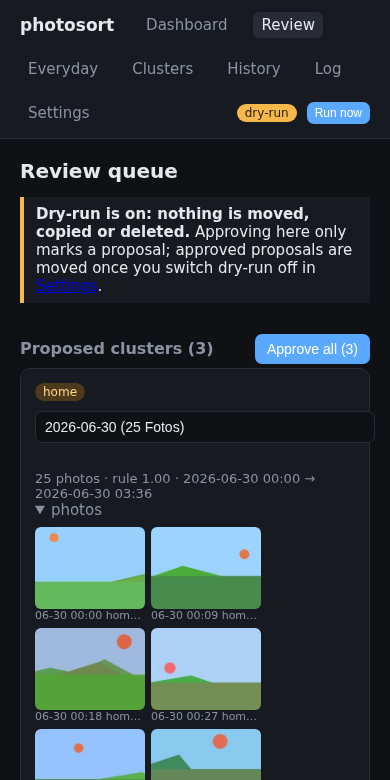

<p align="center"></p>

<p align="center">
  <a href="https://github.com/PhilippMundhenk/photosort/actions/workflows/ci.yml"></a>
  <a href="https://github.com/PhilippMundhenk/photosort/pkgs/container/photosort"></a>
  
  
  <a href="LICENSE"></a>
</p>

# photosort

Sorts the photos and videos from your phones and cameras into folders of trips, day outs and
occasions, by where and when they were taken. It runs on your NAS or a small home server, fully
offline, and moves nothing until you have looked at it in its web page.

```
inbox/phone/…      ─┐                            sorted/2026-06 Lisbon, Sevilla/
inbox/partner/…    ─┼─ photosort ─ you review ─► sorted/2026-06-27 Starnberg/
inbox/camera/…     ─┘                            sorted/_unnamed/2026-06-30 (25 Fotos)/  ← you name it
                                                 sorted/2026/06/                         ← everything else
```

## What it does

- **Trips, day outs and occasions, without typing dates.** Photos away from home form a trip
  when they span a night and a day out otherwise; a burst of photos at home is an occasion you
  name. Folder names come from the places: `2026-06 Lisbon, Sevilla`.
- **Several devices, one library.** Phones, a partner's phone and a camera without GPS: their
  photos meet in the same trip; a camera's shots take their position from the phones around them.
- **You decide.** Dry-run is on until you switch it off. Approve, rename, leave out single
  photos, build clusters by hand, move photos between clusters; every move can be undone.
- **Nothing is final until it moves.** After changing a setting or adding a device, *Start
  over* clusters everything that is not sorted yet again, from scratch.
- **Fits a NAS.** One small container, Synology thumbnails used as they are, moves are renames
  on the share, read-only inboxes work with copy mode.
- **Adjustable.** Every threshold is a setting; expert mode takes rules of your own and shows
  which proposals they would change before you save them.

## Getting started

```yaml
# docker-compose.yml
services:
  photosort:
    image: ghcr.io/philippmundhenk/photosort:latest
    container_name: photosort
    restart: unless-stopped
    user: "1000:1000"                 # the user that owns the photos on the share
    environment:
      TZ: Europe/Berlin               # your home time zone
    volumes:
      - ./data:/data                  # settings, proposals, history (small)
      - /mnt/nas/photos:/photos       # holds inbox/ (one folder per device) and sorted/
    ports:
      - "8080:8080"
```

```sh
docker compose up -d
```

1. Put each device's photos in its own folder under `inbox/` (`inbox/phone/`, `inbox/camera/`).
2. Open `http://<host>:8080`. The first scan starts by itself; home is detected from where most
   photos were taken. Check it under *Settings → Home*.
3. Look at the proposals under *Review*: approve, rename or reject them. With dry-run on, an
   approval only marks a proposal.
4. When the proposals look right, switch dry-run off in *Settings*: approved clusters move.

Mounting a NAS share, permissions, a reverse proxy: [docs/DEPLOYMENT.md](docs/DEPLOYMENT.md).

## Screenshots

| Review: a trip | Everyday photos | Settings |
|---|---|---|
|  |  |  |



## Documentation

* [docs/USAGE.md](docs/USAGE.md) — how sorting works and how to use each page
* [docs/CONFIGURATION.md](docs/CONFIGURATION.md) — every setting, devices that differ, your own rules
* [docs/DEPLOYMENT.md](docs/DEPLOYMENT.md) — Docker, NAS shares, permissions, reverse proxy
* [docs/DEVELOPMENT.md](docs/DEVELOPMENT.md) — code layout, tests and coverage, CI, screenshots
* [docs/DESIGN.md](docs/DESIGN.md) — design notes and the reasons behind the rules

Status: in daily use. Questions and problems:
[GitHub issues](https://github.com/PhilippMundhenk/photosort/issues).
